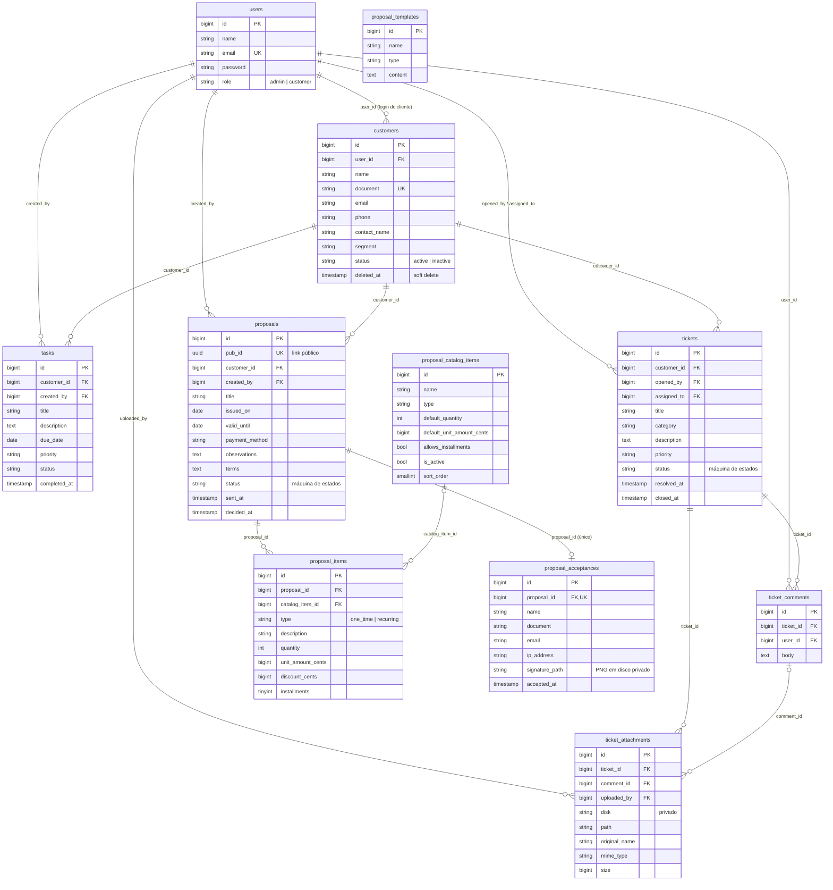

# Modelagem de dados (DER)

Modelo derivado das migrations em `backend/database/migrations`. Tabelas de infraestrutura do Laravel (sessions, cache, jobs, tokens) ficam de fora.

11 tabelas de domínio, 16 migrations.

## Decisões de modelagem
- Dinheiro sempre em centavos inteiros (`*_cents`), sem float.
- Status de proposta e de chamado não estão no `$fillable`: só mudam pelas Actions de transição.
- Cliente com exclusão lógica (`deleted_at`), preservando histórico de propostas e chamados.
- Plano atual do cliente não é coluna: é derivado da proposta aceita mais recente.
- Aceite público identificado por `pub_id` (UUID), nunca pelo id sequencial.
- Assinatura do aceite guardada como arquivo em disco privado; o banco guarda só o caminho.
- Anexos de chamado também em disco privado, servidos por rota autenticada que aplica a mesma regra de acesso do chamado.
- Índices compostos nas consultas de fila: `(customer_id, status)`, `(status, priority)`, `(status, valid_until)`, `(status, due_date)`.
